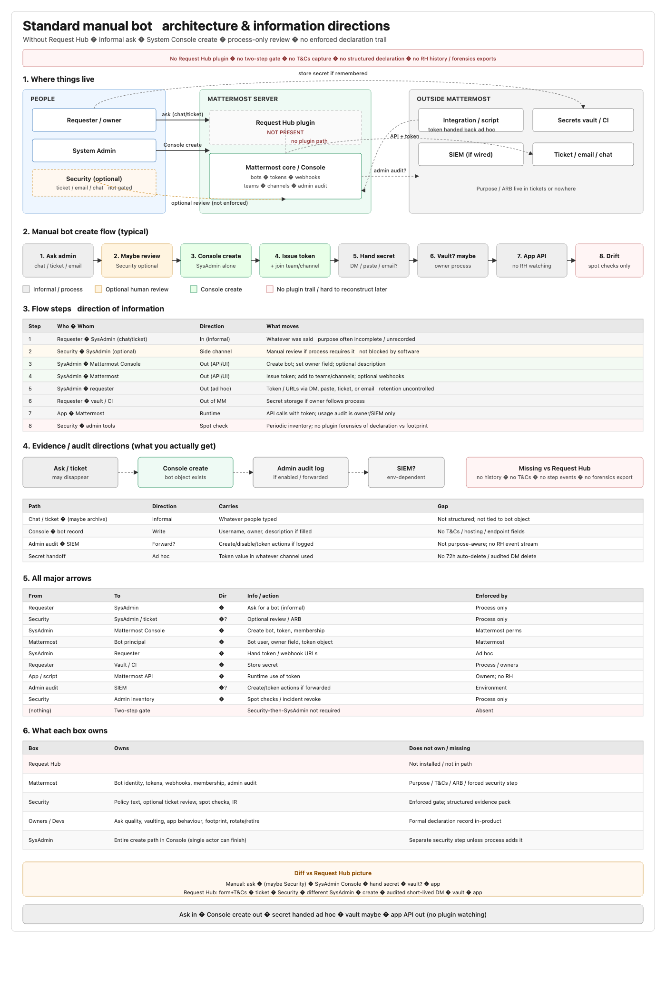
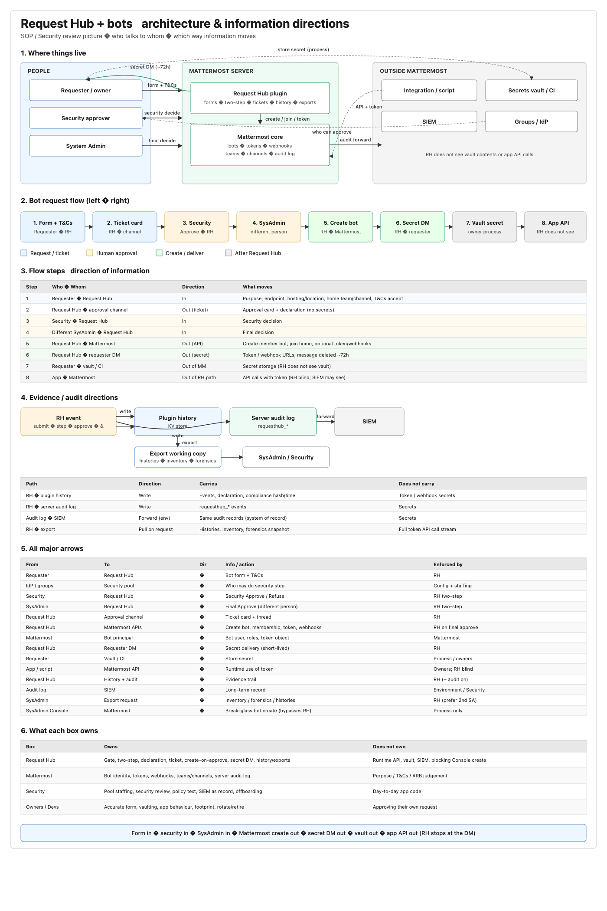

# Bot architecture pictures — manual vs Request Hub

**Purpose:** Side-by-side visuals for SOP / Security review — what a standard manual bot path looks like vs what Request Hub adds.  
**Companion SOPs:** [01 before](./01-sop-before-request-hub.md) · [02 after](./02-sop-after-request-hub.md) · [03 progress](./03-implementation-progress.md)

---

## A. Standard manual bot (no Request Hub)

**Files:** [`manual-bot-architecture.png`](./images/manual-bot-architecture.png) · [`manual-bot-architecture.svg`](./images/manual-bot-architecture.svg)

**One-line:** Ask in → Console create out → secret handed ad hoc → vault maybe → app API out (no plugin watching).

---

## B. Request Hub + bots

**Files:** [`request-hub-bots-architecture.png`](./images/request-hub-bots-architecture.png) · [`request-hub-bots-architecture.svg`](./images/request-hub-bots-architecture.svg)

**One-line:** Form in → security in → SysAdmin in → Mattermost create out → secret DM out → vault out → app API out (RH stops at the DM).

---

## Diff at a glance

| | Manual bot | Request Hub |
| --- | --- | --- |
| Entry | Chat / ticket / email ask | Structured form + T&Cs |
| Security step | Optional process | Enforced first step (pool) |
| Final create | One SysAdmin in Console | Different SysAdmin after security |
| Secret delivery | Ad hoc (DM / paste / email) | Requester DM, ~72h auto-delete, audited |
| Declaration | Informal / often missing | Purpose, endpoint, hosting, home |
| Evidence | Admin audit + tickets (maybe) | Plugin history + `requesthub_*` audit + exports |
| Bypass | Normal path *is* Console | Console still possible (break-glass / process) |

Same section layout on both pictures (where things live → flow → tables → ownership) so you can flip between them in a review.